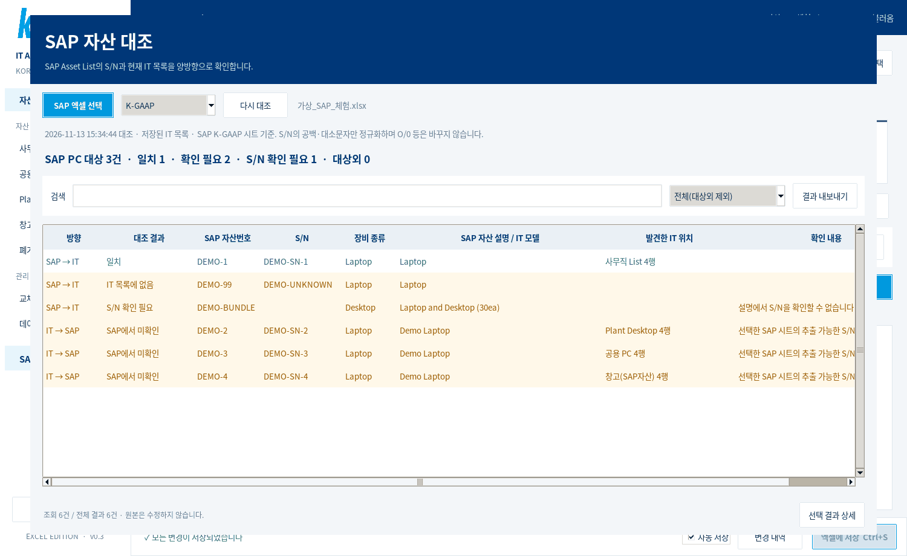
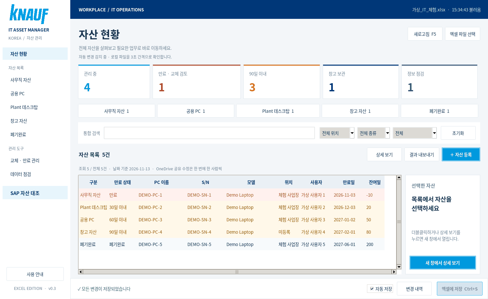
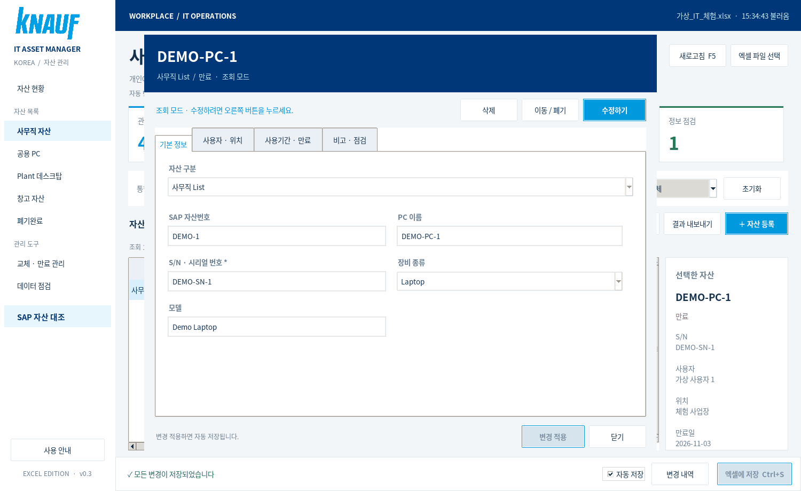

# Knauf IT 자산 관리 v0.3

Windows에서 `launch.bat`으로 실행하고, OneDrive의 기존 Excel 파일을 읽고 수정하는 데스크톱 프로그램입니다.

## v0.3: 자동 저장·외부 변경 반영·SAP 대조
- **자동 저장 기본 켜짐**: 상세 창에서 변경 적용, 등록, 삭제 또는 이동 후 약 0.8초 뒤 백업과 함께 Excel에 저장합니다. 입력 중인 미적용 내용은 저장하지 않습니다. 하단 '자동 저장'을 끄면 수동 저장 방식으로 사용합니다. 설정은 PC별로 기억합니다.
- **외부 변경 감지**: 실행 중 로컬 원본의 SHA-256을 3초마다 비동기로 확인합니다. 외부 변경이 연속 두 번 같은 상태로 확인되고 편집 중이 아니면 자동 갱신합니다. 검색·페이지·필터는 가능한 한 유지합니다.
- **편집 보호**: 미저장 작업이나 자산 상세 창이 열려 있으면 자동 갱신을 보류합니다. 외부 변경이 확인되면 자동 저장도 멈춥니다. 편집 내용을 따로 기록한 뒤 새로고침해 새 파일에 다시 적용하세요. 자동 병합은 제공하지 않습니다.
- **저장 실패 표시**: Excel 잠금, 권한·접근 문제 또는 충돌 시 자동 저장을 중지하고 미저장 상태를 표시합니다. 문제 해결 후 수동 저장 또는 자동 저장을 다시 켜서 재시도하세요.
- **SAP 자산 대조**: 왼쪽 SAP 자산 대조 → SAP 엑셀 선택 → K-GAAP / IFRS / HGB 중 한 시트 선택 → 결과 확인·필터·CSV 내보내기.

**로컬 변경 감지는 OneDrive 클라우드 동기화 상태를 직접 조회하지 않습니다.** 다른 PC의 저장 내용이 이 PC에 내려온 이후에 감지합니다. 원격 미동기화 변경은 확인할 수 없으므로 **한 번에 한 사람만 수정**하는 규칙은 그대로 필요합니다. OneDrive 업로드 완료는 작업 표시줄에서 확인하세요.

### SAP 대조 기준
- 첨부받은 형식처럼 `Asset`과 `Asset description` 열이 있는 회계 시트를 인식합니다. 요약·폐기 시트는 제외합니다. K-GAAP, IFRS, HGB를 동시에 합치지 않으므로 회계 기준 간 중복 집계를 피합니다.
- `S/N`/Serial 열이 있으면 사용합니다. 없으면 자산 설명의 HP 시리얼 패턴, 명시된 S/N 및 `/` 뒤의 식별자에서 추출합니다. 모델명만으로 시리얼을 만들거나 유사 문자열을 강제로 일치시키지 않습니다.
- 공백·대소문자·전각 문자 차이는 정규화합니다. **O와 0, I와 1, 하이픈 차이는 임의로 바꾸지 않습니다.**
- Desktop/Laptop, EliteBook/ProBook/ZBook, EliteDesk/EliteMini 등 설명으로 PC를 분류합니다. 미인식 모델은 대상외 또는 PC 후보로 남을 수 있으므로 대상외 필터도 검토하세요. 대상외 자산을 파일에서 삭제하지 않습니다.
- 결과: **일치 / IT 목록에 없음 / 폐기목록에만 존재 / SAP번호 불일치 / 중복 S/N / S/N 확인 필요 / 종류 확인 필요 / SAP에서 미확인 / 대상외**.
- IT의 장비 종류가 비어 있거나 명확하지 않으면 S/N이 있어도 종류 확인으로 분리합니다. SAP번호가 다른 경우도 S/N 자체의 일치는 별도로 유지합니다.
- 묶음 자산이나 S/N이 적혀 있지 않은 설명은 **S/N 확인 필요**입니다. 실제 자산 누락으로 단정하지 않습니다. 결과 행 수는 물리 장비 수가 아닙니다.
- IT → SAP의 'SAP에서 미확인'은 선택한 기준월·회계 시트의 추출 가능한 S/N에서 못 찾았다는 뜻입니다. SAP 미등록을 확정하는 판정은 아닙니다.
- SAP 파일은 읽기 전용 **스냅샷**입니다. SAP 시스템을 직접 조회하거나 업로드하지 않으며, 원본 SAP 파일을 수정하지 않습니다. SAP 파일이 바뀌면 다시 선택하세요. '다시 대조'는 이미 읽은 SAP 스냅샷과 현재 IT 목록을 다시 비교합니다.
- IT 목록이 변경·자동 갱신되면 열려 있는 SAP 창도 현재 IT 목록으로 다시 대조합니다. 미저장 변경 포함 여부와 대조 시간을 표시합니다.
- CSV는 현재 필터의 결과와 시트·원본 행·추출 방식·대조 시각을 담습니다. 전체 결과가 필요하면 필터를 변경해 내보내세요.

## 기본 관리 기능
- **시트별 페이지**: 사무직 / 공용 PC / Plant 데스크탑 / 창고 / 폐기완료를 왼쪽 메뉴에서 바로 선택합니다.
- **상세 조회 팝업**: 목록 더블클릭, Enter 또는 '상세 보기' → 조회 전용 창 → '수정하기' → '변경 적용'.
- **Knauf UI**: 제공받은 PPT에 포함된 로고와 테마 색상(진한 파랑 `#003778`, 하늘색 `#0099DE`)을 적용했습니다. PPT 전체는 배포하지 않습니다.
- **교체·만료 관리**: 만료 / 만료 및 90일 이내 / 30·60·90일 이내 / 날짜 미등록 필터를 제공합니다.
- **데이터 점검**: S/N 중복·누락, 모델·위치·사무직 사용자 누락, 만료일 미확인, 날짜 순서와 기존 Excel 오류를 조회합니다.
- **이동·폐기**: 상세 창의 '이동 / 폐기'에서 시트를 이동합니다. 원본 사용자·장비 정보를 유지하고, 대상 시트에 없는 항목은 비고에 보관합니다. 폐기완료로 이동하면 교체 알림에서 제외합니다.
- **변경 내역**: 등록·수정·삭제·이동의 미저장 작업 목록을 저장 전에 확인합니다. 세부 값 변경 이력이나 변경자 감사 기록은 아닙니다.
- **통합 검색**: 전체 관리 항목에서 검색합니다. 공백으로 구분한 여러 단어를 함께 검색할 수 있습니다.
- **위치 통합 조회**: Dan / Dangjin / 당진 등을 같은 필터로 조회합니다. 원본의 위치 표기는 변경하지 않습니다.

## 화면 예시 — 모두 가상 데이터

## 실행
1. GitHub ZIP을 내려받고 **압축을 모두 해제**합니다.
2. [Python 3.11 이상](https://www.python.org/downloads/windows/)을 설치합니다. Python Launcher, pip, Tcl/Tk를 포함하세요.
3. `ITAssetManager` 폴더의 **launch.bat**을 실행합니다. 최초 실행은 인터넷으로 openpyxl을 설치하며, 다음부터 전용 `.venv`를 사용합니다.
4. 처음에는 가상 데이터 5건의 체험용 Excel을 자동 생성합니다. 실제 회사 자산 정보는 배포하지 않습니다.
5. 상단의 **엑셀 파일 선택**에서 OneDrive의 `.xlsx`를 선택합니다. 실제 파일은 우선 별도 복사본으로 시험하세요.
6. 하단 **자동 저장** 상태를 확인하세요. 켜져 있으면 변경 적용 후 자동 저장하고, 끄면 **엑셀에 저장**을 눌러 반영합니다. 자동 저장이 켜져 있으면 변경 적용 후 자동 반영되며, 끄면 수동 저장해야 합니다.

처음 지정한 경로는 PC별 `%LOCALAPPDATA%\ITAssetManager\settings.json`에 기억합니다. OneDrive 파일은 '이 장치에 항상 유지'로 설정하세요. 최초 설치가 회사 정책으로 차단되면 IT 담당자에게 요청하세요.

**기존 v0.1 사용자는** 새 ZIP을 별도 폴더에 압축 해제하고 실행하세요. 기존 PC별 경로 설정은 그대로 사용합니다. 배포본 폴더 전체를 실제 Excel 위에 덮어쓰지 마세요.

## 화면과 사용 순서
- 왼쪽에서 역할별 자산 목록을 선택합니다. 각 페이지에서 검색·위치·장비 종류·만료 조건을 조합할 수 있습니다.
- 자산을 한 번 선택하면 오른쪽에서 핵심 정보를 미리 봅니다. 더블클릭하면 별도 상세 창이 열립니다.
- 상세 창은 **기본 정보 / 사용자·위치 / 사용기간·만료 / 비고·점검** 탭으로 나뉩니다. 원본 Excel의 관리 열 B:R을 확인할 수 있습니다.
- 수정하기를 누르면 편집할 수 있습니다. S/N 필수·중복과 날짜 형식을 검사합니다. 기존 수식과 No./잔여개월은 읽기 전용입니다.
- 시작일·사용기간을 입력한 뒤 만료일 계산 버튼을 누르면 만료일이 채워집니다. 기존 수식으로 된 만료일은 덮어쓰지 않습니다.
- 상세 창에서 이동·폐기를 사용하려면 그 창의 편집을 먼저 적용하고 다시 여세요.
- 삭제는 기록 자체를 제거하는 작업입니다. 폐기 이력을 남기려면 삭제 대신 폐기완료로 이동하세요.
- 결과 내보내기는 **현재 화면의 열·필터·정렬 결과**를 UTF-8 CSV로 저장합니다. 전체 원본 백업은 별도입니다.
- 단축키: **Ctrl+F** 검색 / **Ctrl+S** 엑셀 저장 / **F5** 새로고침 / 목록에서 **Enter** 상세 조회.

## 만료와 점검 기준
- 오늘이 만료일이면 30일 이내, 어제 이전이면 만료입니다. 60일·90일 필터는 각각 그 기간 이내를 누적해서 포함합니다.
- Excel 만료일을 먼저 사용하고, 유효한 만료일이 없으면 시작일+사용기간으로 판단합니다. 둘 다 계산할 수 없으면 날짜 미등록입니다.
- 날짜 판단은 실행하는 PC의 오늘 날짜를 사용합니다. '만료'는 원본 만료일 기준이며 제조사 보증을 별도로 조회하지 않습니다.
- 관리 중 숫자는 폐기완료를 제외한 보유 자산입니다. 만료·90일·창고·점검 카드도 클릭하여 관련 목록으로 이동할 수 있습니다.
- 점검 화면은 수정 전 검토 목록입니다. 기존 중복 S/N을 자동 병합하거나 누락 정보를 임의로 채우지 않습니다.
- 폐기완료는 만료 알림에서 제외합니다. S/N·모델 및 기존 Excel 수식 오류 점검은 폐기완료에도 적용합니다.

## OneDrive 공유 사용
**한 번에 한 사람만 수정해야 합니다.** 이 앱은 로컬 Excel 파일을 쓰며 OneDrive 전체에 걸친 서버 잠금이나 실시간 동시 편집은 제공하지 않습니다.
1. 수정자가 다른 사용자에게 수정 시작을 알립니다.
2. OneDrive 동기화 완료 후 프로그램에서 새로고침합니다.
3. 수정 → 자동 저장 완료(또는 수동 저장) → 동기화 완료 확인 후 다음 사용자에게 넘깁니다.
다른 사람은 조회하더라도 편집자의 저장·동기화 후 새로고침해야 최신 정보를 봅니다. Excel에서 원본을 열어둔 채 앱으로 저장하지 마세요.

저장 전 파일 해시 비교로 **이 PC에 이미 반영된 외부 변경**을 감지하며, 저장 준비 중에도 다시 확인합니다. 원격 PC의 미동기화 변경과 검사 직후의 다른 프로세스 쓰기를 완전히 차단하지는 못합니다. `.lock`은 이 PC의 앱 저장 작업을 조정하며 OneDrive의 분산 잠금이 아닙니다.
충돌 안내가 나오면 편집 내용을 별도로 기록하고 새로고침한 뒤 재입력하세요. 자동 병합은 지원하지 않습니다.
강제 종료로 `.xlsx.asset-manager.lock`이 남았다면 다른 저장 작업 및 사용자의 수정이 없음을 확인하고 그 잠금 파일만 지우세요.

## 백업·원본 보존·복구
- 저장마다 Excel 옆 **IT자산_백업** 폴더에 저장 직전의 파일을 날짜·시간 이름으로 보관합니다. 백업을 자동 삭제하지 않습니다.
- 복구 시 앱과 Excel을 닫고 백업을 복사하여 원본을 교체한 후 새로고침하세요. 백업에도 원본과 같은 접근 권한을 적용하세요.
- 새로고침은 미저장 변경을 모두 버립니다. 저장 후 취소는 백업으로 복구합니다. 앱 내부 휴지통은 없습니다.
- 삭제·시트 이동 시 원본 행의 B:R만 비우며 다른 행을 당기지 않습니다. 이동 시 이름이 같은 열 및 사용자 열을 맞추고, 대상에 없는 열은 비고에 보관합니다. 기존 상대 수식은 새 행 위치에 맞게 옮깁니다.
- 원본의 기존 서식·수식·표는 openpyxl 지원 범위에서 보존합니다. Excel 전용 고급 개체까지 완전 보존을 보장하지 않으므로 복사본으로 먼저 검토하세요.
- '현황', 'SN검사'는 집계 시트로 보존하고 자산으로 중복 등록하지 않습니다. 앱의 수량·만료·중복은 다섯 자산 시트에서 직접 계산합니다.
- openpyxl은 Excel 수식을 계산하지 않으며 저장 시 수식 캐시가 비워질 수 있습니다. 기존 집계 시트와 수식 값은 **Excel에서 열어 재계산·저장해야** 최신화됩니다. 기존 오류를 자동 수정하지 않습니다.
- 새 등록에 기존 수식을 자동 채우지는 않습니다. 만료일 계산 버튼은 사용할 수 있습니다.
- 변경자 감사 기록, 이메일 알림, 실시간 다중 편집·클라우드 동기화 상태 직접 조회, 설치형 EXE는 이번 버전에 포함하지 않습니다.

## 검증
- `python -m unittest -v`: 가상 데이터 기반 21개 테스트. 변경 감지 정책, SAP 시리얼 추출·정규화, 양방향 대조·중복·원본 보존·넓은 서식 영역 처리도 검증합니다. 저장 전 원본 보존, 백업, 외부 충돌, S/N 검사, Excel 잠금, 삭제, 시트 이동 및 사용자 매핑, 수식 이동, 실패 시 복구, 만료 경계를 검증합니다.
- Linux Tk 8.6에서 기존 화면과 실제 자동 저장 타이머·백업, 외부 변경 자동 갱신, 편집 충돌 보호, SAP 비동기 파일 선택·대조 UI를 검증했습니다.
- 제공받은 실제 Excel의 로컬 복사본에서도 기존 255행 조회와 저장·백업·수식 보존을 검증했습니다. 실제 SAP 파일도 K-GAAP/IFRS/HGB 인식과 대조·원본 불변을 확인했습니다. 회사 Excel 파일은 GitHub에 포함하지 않습니다.
- Windows BAT 자체는 Windows PC에서 확인이 필요합니다.

## 오류 기록
GUI 오류는 `%LOCALAPPDATA%\ITAssetManager\error.log`에 기록됩니다. 파일 경로 등 업무 정보를 확인한 후 필요한 부분만 공유하세요.
